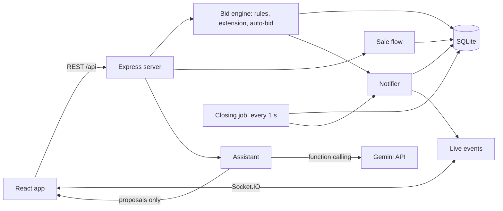

# Campus Auction

A fair, transparent auction marketplace for campus items. Seniors leaving campus list cycles, calculators and books; juniors bid in public, and every item has its own countdown. It replaces chat groups where the fastest reply wins and the price is a guess.

## What it does

### The basics (all required items)

| Brief requirement | How it works here |
|---|---|
| Listings | Title, category, description, condition, 1-5 photos, starting price, minimum increment and an item-specific closing time. |
| Edit / cancel | Only the seller can. After the first bid, price, closing time and item details are locked (only the description can improve and photos can be added), so the deal can't change under bidders. Cancellation records a reason and notifies bidders. |
| Browsing | Keyword search (every word must match), filters for category, condition, price range and "closing in 24h", plus sorting. |
| Auction page | Details, leading bid, full public bid history, public auto-bid maximums and a live countdown synced to the server clock. |
| Bid rules | First bid at least the starting price; later bids at least current price + increment. Checked on the server in one transaction, so simultaneous bids can't both win (tested with 5 parallel bids). |
| Closing | A server job closes auctions every second. Highest bid becomes the provisional winner; no bids means **Unsold**. |
| Sale | Seller approves (item **Reserved**, winner gets a private 4-digit pickup code) or rejects with a reason. Seller enters the buyer's code at the campus handover to mark it **Sold**. Seller or winner can report **Pickup failed**. Every outcome is recorded and shown. |
| Notifications | Alert bell with history (stored, so offline students see them later), in-app pop-ups, and opt-in browser notifications shown when the tab is in the background. |

### Key features (all five built)

| Feature | How it works here |
|---|---|
| Last-minute extensions | A valid bid with 30 s or less left moves closing to 60 s after that bid. Everyone watching sees the countdown jump and a banner. Automatic bids extend too. |
| Automatic bidding | A buyer sets a maximum; the app bids only one increment above the competition, never above the maximum. Higher maximum wins at one step above the lower; equal maximums go to whoever set it first. All maximums are public. |
| Never miss what you need | Saved searches ("scientific calculator, up to ₹400"). New matching listings create an alert that waits for offline students. One click on Browse saves the current filters. |
| AI assistant tab | "Find me a cycle under ₹2,000" gets a straight answer. It can prepare an automatic bid or a saved search, but has **no tool that acts**: a confirmation card appears and only the student's click calls the normal endpoint. It never proposes above the stated limit (asks when none is given) and never sees emails, user ids or bidder identities. Uses Gemini function calling, with an offline rule-based mode used when no key is set or Gemini fails. |
| Questions before bidding | Similar questions (with answers) are shown while typing; near-duplicates are refused and point to the existing one; "I have the same question" subscribes you to the answer. Spam limits: login required, 8-300 chars, no links, 3 per item, 30 s cooldown, seller can hide. Answered questions feed the assistant. |

### Why this order

1. **Basics first**, because nothing else matters if bids are unfair or closing is wrong.
2. **Last-minute extension** next: tiny change inside the bid engine, very visible fairness win.
3. **Automatic bidding**: highest user value for students who can't watch the app, and the AI assistant needs it.
4. **Saved searches**: reuses search and notifications; solves "listed while I was in class".
5. **AI assistant**: reuses search, auto-bid and saved searches, so it adds a new way in without new rules.
6. **Q&A** last: valuable, but independent of the others.

## Architecture



- **One bid engine** (`server/src/services/bidEngine.js`): manual bids, automatic bids and assistant-prepared bids all go through it, so the rules can't be bypassed.
- **Server clock is the referee**: all deadline checks happen on the server; the browser countdown is corrected with the server time sent in every response.
- **Privacy**: public responses show display names only; emails are never returned for other students; the pickup code is only sent to the winner.

Status flow: `live` -> `unsold` | `cancelled` | `awaiting_seller` -> `rejected` | `reserved` -> `completed` | `failed_pickup`.

## Stack

- Client: React + TypeScript (Vite), plain CSS
- Server: Node.js + Express 5 + Socket.IO
- Database: SQLite (better-sqlite3), single file, no setup
- AI: Google Gemini via `@google/genai` (optional)

## Run locally

Requires Node.js 20 or newer.

```powershell
# terminal 1 - server
cd server
copy .env.example .env   # then set JWT_SECRET (and GEMINI_API_KEY for the assistant)
npm install
npm run dev              # http://localhost:4000/api/health

# terminal 2 - client
cd client
npm install
npm run dev              # http://localhost:5173
```

## Demo data

```powershell
cd server
npm run seed              # adds 5 demo students and 8 live auctions (keeps existing data)
npm run seed -- --reset   # WARNING: deletes ALL data first, then seeds a clean demo
```

All demo accounts use the password `demo1234`: `ravi@campus.demo` and `meena@campus.demo` (sellers), `priya@campus.demo`, `arjun@campus.demo`, `karthik@campus.demo` (buyers). Closing times are relative to when you seed (some close in 3, 6 and 12 minutes), so seed shortly before a demo.

## Tests

```powershell
cd server
npm test                               # unit tests (in-memory database)
node scripts/smoke-listings.js         # live checks against a running server
node scripts/smoke-bidding.js
node scripts/smoke-sale.js
node scripts/smoke-saved-searches.js
```

## Demo script (about 5 minutes)

Run `npm run seed -- --reset` right before you start: the study lamp closes 3 minutes later, the calculator 6 minutes later and the Ladybird cycle 12 minutes later. Use two browser windows (one normal, one incognito).

1. **Browse and search** as a visitor: search "calculator", filter by price, note each item's own countdown.
2. **Fair bidding**: log in as Priya and Arjun in the two windows and bid on the Casio calculator. Too-low bids are refused; the other window updates live; the outbid student gets an alert.
3. **Last-minute extension**: bid when under 30 s are left. Both countdowns jump to about 60 s.
4. **Automatic bidding**: on the Hero cycle, see Karthik's public ₹1,800 maximum. Set a higher maximum as Priya and watch it outbid by exactly one step.
5. **Assistant**: "Bid for me on a cycle up to ₹2,000". Show the confirmation card; nothing happens until Confirm.
6. **Q&A**: ask "Do the brakes work?", answer it as Ravi, then start typing a similar question to show the "already asked" hint.
7. **Never miss it**: as Ravi, sell a "scientific calculator" for ₹300. Priya (saved search) gets an alert.
8. **Closing and sale**: the study lamp closes **Unsold**; the Ladybird cycle closes with a winner. As Meena, approve; as Priya, read the pickup code; as Meena, enter it. Status becomes **Sold**.
